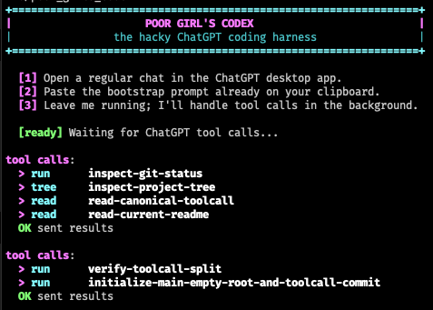
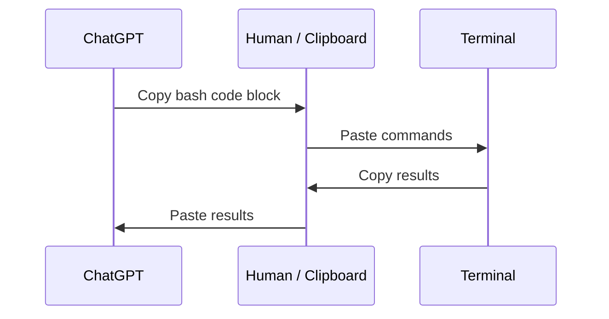
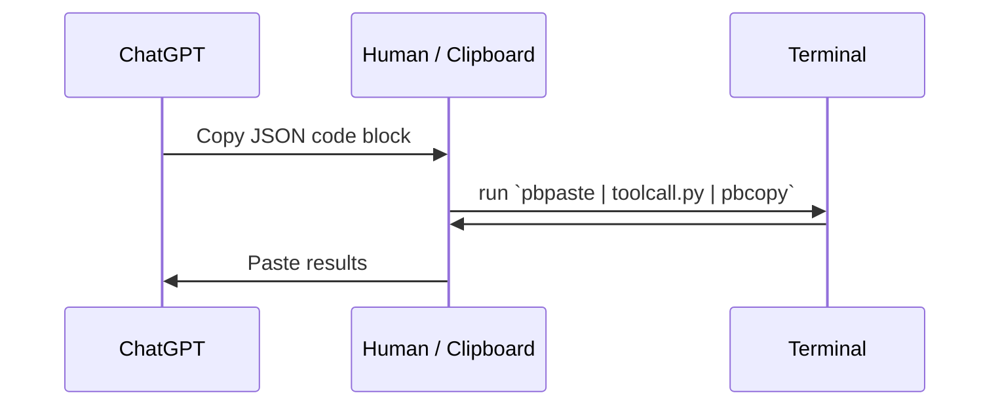
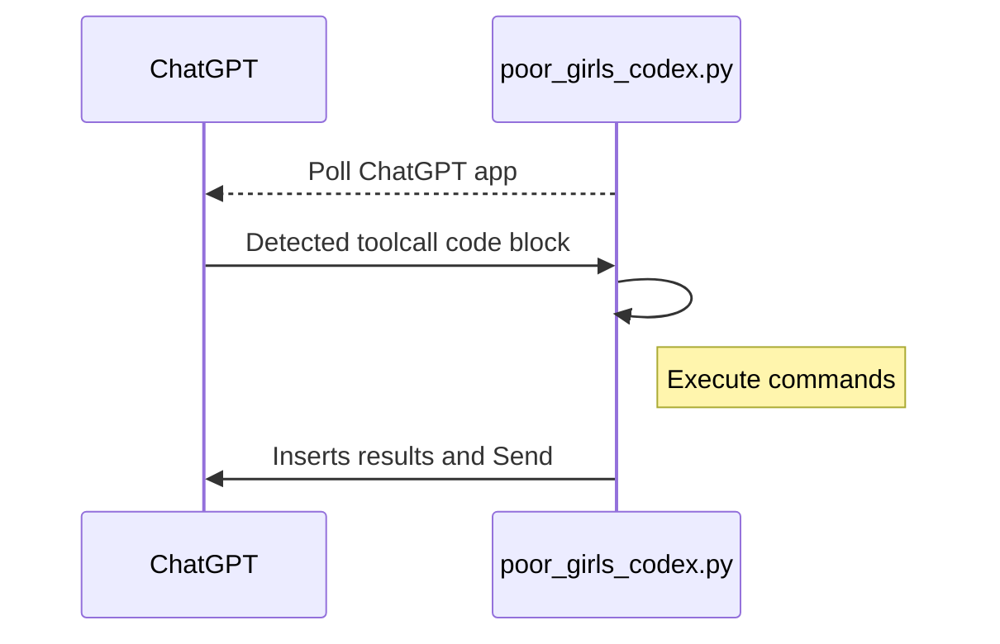

# Poor Girl's Codex

Poor Girl's Codex is a tiny, semi-ridiculous coding-agent harness for ChatGPT in a Chromium browser.

It started as a workaround; I'd run out of Codex credits, and needed to keep working. Originally, I switched to Chat mode and said: "You do the thinking and coding, and I will be your "tool call" executor by manually executing code snippets in a terminal and pasting the results".



But I quickly realized this was going to be exhausting. I would have to be selecting enormous amounts of text. And ChatGPT would have to edit large code bases via `sed` and `awk`, which is awkward (pun intended).

So instead, we made a small Python program called `toolcall` that implemented a handful of standard harness tools (`read`, `write`, `edit`, `run`). By combining that with the existing commands `pbcopy` to read from the Clipboard and `pbpaste` write to to the Clipboard, we were able to build a less tedious, more robust loop:



That worked surprisingly well. More importantly, it made the mechanics of an AI coding agent impossible to miss: the model writes structured data, ordinary software validates and executes it, the result is appended to the chat, and the model gets another turn.

From there, it was pretty easy to remove the human-in-the-loop. The current harness connects to a Chromium browser over CDP, watches ChatGPT conversations in the background, and reacts to tool calls without hijacking the mouse or keyboard.



## What it does

Run:

```sh
./poor_girls_codex
```

The default `watch` mode:

1. copies a bootstrap prompt to the clipboard,
2. watches attached ChatGPT browser conversations through Playwright/CDP,
3. detects the newest valid Poor Girl's Codex JSON tool request,
4. waits briefly to avoid executing a partially streamed response,
5. executes the request in-process using `toolcall_lib`,
6. places the JSON result into the ChatGPT composer,
7. submits it back to ChatGPT,
8. and repeats.

The model can therefore perform a normal coding-agent loop:

```text
inspect -> reason -> edit -> test -> inspect -> reason -> ...
```

without a purpose-built agent runtime.

The harness currently exposes these tools:

| Tool     | Purpose                                                |
| -------- | ------------------------------------------------------ |
| `read`   | Read UTF-8 files with line ranges and SHA-256 metadata |
| `find`   | Search files with ripgrep                              |
| `tree`   | Inspect directory structure                            |
| `status` | Read Git status                                        |
| `diff`   | Read Git diffs                                         |
| `edit`   | Perform exact, optionally SHA-guarded textual edits    |
| `write`  | Create or replace files                                |
| `run`    | Execute commands or Bash scripts with captured output  |

Requests may be single calls, arrays of calls, or batches of the form:

```json
{
  "calls": [
    {
      "id": "inspect",
      "tool": "read",
      "path": "src/example.py",
      "start": 1,
      "end": 100
    },
    {
      "id": "tests",
      "tool": "run",
      "command": ["uv", "run", "python", "-m", "unittest", "discover", "-s", "tests", "-p", "test_*.py"]
    }
  ],
  "stop_on_error": true
}
```

Every result carries the original call ID, tool name, success state, and tool-specific output.

## Why this is interesting

Poor Girl's Codex is useful partly because it is *not* sophisticated.

Modern AI-agent systems can look mysterious because their tool layer is hidden behind product APIs, orchestration frameworks, proprietary runtimes, or elaborate SDKs. That can create the impression that "agentic AI" requires some fundamentally different kind of model.

This project makes the opposite point in a few hundred lines of ordinary Python.

At the core, function calling is just a protocol:

```text
model emits structured request
        |
        v
host validates request
        |
        v
host performs side effect
        |
        v
host serializes result
        |
        v
model observes result
```

The model never directly reads a file, launches a process, edits source code, or talks to Git. It asks the host to do those things by producing data in an agreed-upon format.

Likewise, there is no magical boundary between a "chatbot" and a "coding agent." Give a conversational model:

- a sufficiently precise tool protocol,
- a loop that feeds tool results back into the conversation,
- and permission to continue until a task is complete,

and you have most of the conceptual machinery of an agent.

Poor Girl's Codex is therefore an intentionally inspectable example of concepts that are often buried inside larger systems:

- **tool schemas** — the contract between model and host,
- **function calling** — structured model output interpreted as a request,
- **tool dispatch** — mapping a tool name to ordinary code,
- **observation** — serializing execution results back to the model,
- **agent loops** — repeatedly alternating reasoning and external action,
- **idempotence and replay concerns** — avoiding accidental re-execution of the same call,
- **streaming hazards** — ensuring partially generated JSON is not executed early,
- **capability boundaries** — the model can only do what the host exposes,
- **stale-write protection** — SHA-guarded edits make concurrent mutation visible,
- **human-in-the-loop transport** — the original clipboard version demonstrates that automation is convenience, not a conceptual requirement.

You can read essentially the entire agent runtime yourself.

That is the educational value of the project.

## Architecture

There are three main pieces.

### `toolcall_lib.py`

The actual local tool implementation.

It parses requests, validates arguments, dispatches tools, captures results, bounds output sizes, and turns failures into structured JSON responses.

This file is also preserved almost verbatim as the second commit in the repository's history, where it originally existed as the standalone `toolcall` program.

### `poor_girls_codex.py` and `chatgpt_web.py`

The autonomous bridge to ChatGPT in Chromium. `poor_girls_codex.py` owns the protocol, tool execution, bootstrap prompt, and CLI while `chatgpt_web.py` owns browser/session discovery and transport.

Together they:

- connect to Chromium over CDP,
- track ChatGPT conversation tabs and subagents,
- inspect the newest assistant response for tool-call JSON,
- validate requests before considering them executable,
- fingerprint calls so they are not repeatedly executed,
- wait for streamed output to settle,
- invoke `toolcall_lib` directly,
- inject results into the composer,
- and submit them back to ChatGPT.

## Requirements

Poor Girl's Codex uses Python 3.14. The default `chatgpt-web` backend uses Playwright and a Chromium browser launched with a CDP endpoint. The experimental `terminal-browser` backend instead requires the `terminal-browser` command and uses its bundled agent-browser transport.

Install dependencies with the project's normal `uv` workflow, then grant Accessibility permission to the terminal application from which Poor Girl's Codex is launched:

```text
System Settings
  -> Privacy & Security
  -> Accessibility
```

The ChatGPT desktop application must be running with an ordinary conversation open.

## Testing

Poor Girl's Codex uses Python's standard-library `unittest` framework. `pytest` is not a project dependency.

Run the complete test suite through the project's `uv` environment:

```sh
uv run python -m unittest discover -s tests -p 'test_*.py'
```

Run one test module while iterating on a focused change:

```sh
uv run python -m unittest tests.test_chatgpt_web
```

For a quick syntax check of files you changed, `py_compile` is also useful:

```sh
uv run python -m py_compile chatgpt_web.py tests/test_chatgpt_web.py
```

Agents working in this repository should prefer these commands instead of assuming `pytest` is installed.

## Design principles

A few constraints emerged during development and became part of the character of the project:

**Keep the protocol visible.** Tool requests and results are plain JSON. There is no opaque RPC layer required to understand what is happening.

**Prefer constrained operations.** Reading, exact editing, diffing, and searching are first-class operations; arbitrary shell execution exists, but the model does not have to reach for it for everything.

**Fail visibly.** Tool failures are serialized back to the model rather than silently disappearing.

**Avoid stale edits.** Tools can require an expected SHA-256 before modifying a file.

**Do not hijack the machine.** Normal autonomous operation avoids moving the mouse, activating ChatGPT, or taking over the global keyboard stream.

**Do not make the clipboard the runtime.** The clipboard-based version was useful as the bootstrap experiment. The current watcher reads assistant output directly from Accessibility and only uses the clipboard for the initial prompt convenience.

**Stay hackable.** This is intentionally a small program, not an agent framework. A curious reader should be able to trace an entire tool request from generated JSON to local side effect and back again.

## A note on the name

The name came from the project's origin as a low-budget, slightly ridiculous substitute for a dedicated coding-agent interface: if the useful part of Codex is ultimately a model exchanging structured tool calls with a host program, perhaps we can build the poor girl's version ourselves.

It turns out we can.

And because the result exposes the machinery so directly, the cheap workaround became a useful teaching tool in its own right.

## ChatGPT web interface

PGC can also watch multiple existing ChatGPT browser conversations concurrently using Playwright over Chrome DevTools Protocol:

```bash
poor_girls_codex --interface chatgpt-web
```

Chrome must already be running with a remote-debugging endpoint. The default is `http://127.0.0.1:9222`; use `--cdp-url` to override it. Each open `chatgpt.com/c/...` tab becomes an independent session with its own tool-call fingerprints, pending results, and delivery retries. New conversation tabs are discovered automatically. PGC does not foreground, focus, launch, or close the browser.

After a terminal response, PGC reloads the idle conversation every five minutes so messages sent from another device become visible. The timer stops when activity resumes, and reloads wait while the composer contains a draft. This applies to both browser backends.

To start a **fresh ChatGPT conversation without the interactive conversation picker**, pass `--new` (also spelled `--new-conversation`):

```bash
poor_girls_codex --interface chatgpt-web --new
# Or with the experimental terminal-browser interface:
poor_girls_codex --interface terminal-browser --new
```

This skips both discovery of an already-open root conversation and the saved-conversation picker, and instructs the watcher to create a new root tab even if an older session is open. It does not clear conversation history or rotate the working directory's routing id. For a different codebase, launch the PGC executable with that project's directory as the working directory (for example, from `../fpgatool`). PGC's `run` tool waits for its child process to exit, so launching another long-running watcher through `run` requires detaching the child and redirecting its standard streams.

Each working directory gets a persistent opaque routing id in `.pgc/session`. Every executable web tool request must repeat that id in a top-level `"session"` field. This lets multiple PGC processes watch the same browser while only executing requests for their own project. PGC automatically adds `.pgc/session` to that Git checkout's local `info/exclude`, so the routing id stays local and uncommitted.

### Web subagents

In `chatgpt-web` mode, a conversation can create a fresh ChatGPT subagent tab with the `subagent {name,prompt}` orchestration tool. Subagent names are alphanumeric, and the child receives a derived routing id of `<parent-session>::<name>`. Because routing matches the current session tree, children can create nested subagents using the same convention.

The new tab receives the requested subagent prompt followed by the normal PGC bootstrap for its derived session. When ChatGPT replaces the temporary `WEB:...` conversation id used by a newly created tab with its permanent conversation id, the watcher rekeys the existing session instead of detaching it, so pending state and the child's first tool call are preserved.

A subagent returns completed work with `handoff {result}`. PGC queues that result onto the immediate parent conversation; nested subagents therefore hand off one level at a time. The root conversation has no parent and cannot use `handoff`.

See `docs/chatgpt-web-poc.md` for architecture, browser requirements, DOM assumptions, and the live POC results.

### Experimental terminal-browser backend

PGC also has an experimental secondary transport for [terminal-browser](https://github.com/zenbu-labs/terminal-browser). The normal Playwright/CDP `chatgpt-web` backend remains the default.

With `terminal-browser` installed, run:

```bash
./poor_girls_codex --interface terminal-browser
```

This backend first discovers the terminal-browser associated with the current terminal tab using `terminal-browser ls --json` and targets individual browser tabs through `terminal-browser action`. That terminal-tab scoping is ideal when Pixel has a pane adapter for the terminal. iTerm2 is a special case because Pixel currently cannot identify its panes: PGC asks iTerm2 for the TTYs of every session in the current iTerm tab, then filters `terminal-browser ls --all --json` to browser processes running on one of those TTYs. A browser in another iTerm tab is therefore never adopted, even when it is the only browser running globally. Each PGC iTerm tab owns its own terminal-browser instance. The backend reuses PGC's existing multi-conversation watcher, routing ids, delivery retries, and subagent orchestration, but browser interaction itself goes through terminal-browser/agent-browser rather than Playwright.

On terminals that terminal-browser can manage directly, `terminal-browser new-tab` can create the browser when needed. iTerm2 supports the Kitty graphics protocol needed for rendering, but Pixel currently has no iTerm2 pane-management adapter. When PGC is launched from iTerm2 and the current iTerm tab has no terminal-browser yet, PGC uses iTerm2's AppleScript API to split the current session vertically (creating a pane to the right with the same profile) and launches `terminal-browser open` there. That new pane's TTY becomes part of the current tab's ownership set, so subsequent ChatGPT conversations and subagents stay inside that browser. Existing ChatGPT tabs in the tab-owned browser are discovered automatically. PGC never shuts down the user's terminal-browser process when it exits.

This path is intentionally experimental. Message discovery still uses a small amount of ChatGPT DOM inspection. Composer submission uses terminal-browser's semantic accessibility layer to focus the ChatGPT textbox, explicitly clears any restored draft, inserts the payload with agent-browser's paste-like `keyboard inserttext` operation, verifies the exact logical ProseMirror text and enabled Send button, then clicks Send exactly once. This avoids both contenteditable append behavior and duplicate delivery when ChatGPT is slow to expose the submitted turn. Submission-too-long errors are detected from ChatGPT's hidden transition layer so PGC can fall back to the compact result without re-executing tools. Subagent retirement closes its terminal-browser tab without attempting ChatGPT's UI-level Archive action.
